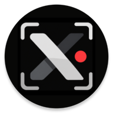

<div align="center">

  

# ScreenX

**Pure, powerful screen recording for Android. Zero limits, zero nonsense.**

  <p>
    <a href="https://github.com/gtxprime/screen-x/releases/latest">
      
    </a>
    <a href="https://github.com/gtxprime/screen-x/stargazers">
      
    </a>
    <a href="https://github.com/gtxprime/screen-x/network/members">
      
    </a>
    <a href="https://github.com/gtxprime/screen-x/blob/main/LICENSE">
      
    </a>
    <a href="#">
      
    </a>
    <a href="https://github.com/gtxprime/screen-x/releases/latest">
      
    </a>
    <a href="https://hub.xerj.org/contributors/gtxPrime">
       
    </a>
  </p>

  <a href="https://github.com/gtxprime/screen-x/releases/latest">
    
  </a>

  <h3>
    <a href="#-about-screenx">About</a>
    <span> &bull; </span>
    <a href="#-recording-modes-comparison">Engine Comparison</a>
    <span> &bull; </span>
    <a href="#-features">Features</a>
    <span> &bull; </span>
    <a href="#-tech-stack--architecture">Tech Stack</a>
    <span> &bull; </span>
    <a href="#-project-structure">Project Structure</a>
    <span> &bull; </span>
    <a href="#-installation--build">Installation</a>
    <span> &bull; </span>
    <a href="#-roadmap">Roadmap</a>
  </h3>

</div>

---

## <a id="-about-screenx"></a> About ScreenX

> [!NOTE]
> **ScreenX** is an open-source, rootless, high-performance screen recording studio engineered for modern Android devices. Designed with Jetpack Compose, AGSL hardware shaders, and dual recording architectures (Standard MediaProjection & Stealth Wireless ADB), ScreenX offers complete freedom over video quality, multi-source audio mixing, live drawing, and background stealth capture.

---

## <a id="-recording-modes-comparison"></a> Dual Recording Engine Comparison

ScreenX offers two completely distinct capture pipelines to fit any recording situation:

| Feature / Capability | Standard Capture (`MediaProjection`) | Stealth Capture (`Wireless ADB`) |
| :--- | :---: | :---: |
| **Detection by Apps** | Standard API (Apps can detect active capture) | **100% Undetected** (Bypasses app listeners like Snapchat) |
| **System Capture Prompt** | OS confirmation dialog on launch | **Zero System Dialogs** (Completely invisible start) |
| **Audio Capture** | Internal System Audio, Mic, or Synchronized Dual Audio | **Acoustic Speaker Audio** (Mic DSP + Noise Clearing + Gain Boost) |
| **Duration Limit** | Unlimited (Device storage bound) | **Unlimited** (Auto-continues past 3 min & lossless merge) |
| **Root Required?** | ❌ No Root Required | ❌ **No Root Required** (Uses Wireless Debugging pairing) |
| **Floating Overlay & Brush** | ✅ Supported | ✅ Supported |
| **Quick Settings Tile** | ✅ Instant 1-Tap Trigger | ✅ Instant 1-Tap Trigger |
| **Protected Views (`FLAG_SECURE`)** | Rendered as black screen (OS constraint) | Rendered as black screen (OS constraint) |

---

## <a id="-features"></a> Core Features

###  Stealth Recording (Wireless ADB)
> Completely rootless, background recording without system prompts or app-level detection.

*  **Undetected by Screen-Monitoring Apps:** Runs via a local Android Debug Bridge (ADB) daemon session outside the `MediaProjection` API surface. Apps that monitor recording callbacks (such as Snapchat or protected chat screens) cannot detect the session.
*  **Acoustic Speaker Audio Capture:** Android's internal `screenrecord` binary cannot record audio. ScreenX bridges this by recording speaker audio acoustically via microphone DSP with:
  * **2.5x Pre-amp Volume Gain:** Ensures game audio and app speech are clearly audible.
  * **Soft-Knee `tanh` Saturation Limiter:** Eliminates harsh clipping and digital distortion.
  * **Hardware Noise Suppression & Rumble Filter:** Cuts out ambient room hum and fan vibrations.
  * **Lossless Muxing:** Remuxes real-time AAC audio with the video track with synchronized PTS timestamps.
*  **Auto-Continue Past 3 Min & Merge:** Bypasses Android's hardcoded 3-minute `screenrecord` limit. When the segment expires, ScreenX automatically spins up the next recording segment without gaps and losslessly joins all parts into a single video file upon stopping.
*  **1-Tap Notification Pairing:** Pair your device with Android 11+ Wireless Debugging easily: tap Reply directly on the ScreenX notification and submit your 6-digit code.
*  **Zero-Config mDNS Discovery:** Automatically scans and resolves wireless debugging ports dynamically when Wi-Fi or developer options toggle.

> [!IMPORTANT]
> **Limitations & `FLAG_SECURE`:** Stealth Recording **cannot bypass Android's OS-level `FLAG_SECURE`**. Banking apps, DRM content (Netflix, Prime Video), or screens that explicitly enforce `WindowManager.LayoutParams.FLAG_SECURE` will be rendered black by Android's hardware surface flinger.

---

###  High-Fidelity Recording & Orientation Fixes
> Crystal-clear video output tailored to your display hardware.

*  **Flexible Settings:** Customize resolutions (720p, 1080p, 1440p+), frame rates (30, 60, 90, 120 FPS), and bitrates (up to 24+ Mbps).
*  **Hardened Orientation Safeguards (Custom ROM Fix):**
  * Resolves landscape pillarboxing and upside-down bugs on affected devices and custom ROMs (InfinityX, crDroid, LineageOS, etc.) where window metrics report portrait bounds during landscape capture.
  * Hard-enforces `screenWidth = maxOf(w, h)` and `screenHeight = minOf(w, h)` during landscape gameplay.
  * Simplified, intuitive orientation options: **Auto**, **Portrait**, and **Landscape**.

---

###  Audio Subsystem & Dual Sound
> Studio-grade audio capture for tutorials, gameplay, and podcasts.

*  **Synchronized Dual Audio:** Record internal game audio and microphone voice simultaneously with mathematical sample interleaving and zero sync drift.
*  **Multiple Audio Sources:** Choose between **Mute**, **Microphone**, **Internal System Audio** (Android 10+), or **Dual Audio**.
*  **Voice Priority & Vocal Clarity:** Automatic ducking lowers background game music when speaking, backed by an acoustic clarity filter.

---

###  Live Annotations & Brush Overlay
> Draw and annotate live over apps while recording.

*  **On-Screen Canvas:** Full-screen transparent overlay allows real-time drawing, highlighting, and writing.
*  **Customizable Brush:** Dynamically select color swatches and adjust line thickness.
*  **Instant Clearing:** Undo or erase strokes with one tap without interrupting the video stream.

---

###  Floating Controls & Quick Settings Tile
> Control recordings effortlessly from anywhere on your device.

*  **Magnetic Floating Bubble:** Draggable floating pill that snaps to screen edges, expandable for quick access to record, pause, screenshot, and brush tools.
*  **Quick Settings Tile Integration:** Start or stop Standard or Stealth recordings in one tap directly from Android's notification shade.

---

###  Built-in Video Trimmer & Media Gallery
> Review, manage, and edit your recordings without third-party apps.

*  **Lossless Video Trimming:** Quick start-point and end-point trimming using MediaExtractor and MediaMuxer without re-encoding quality loss.
*  **Built-In Gallery:** Browse screenshots and video recordings with file details, thumbnail previews, and batch deletion.

---

###  Multi-Language Localization
> Fully translated interface for global users.

* Complete translations across **English**, **Spanish (Español)**, **Russian (Русский)**, **Ukrainian (Українська)**, and **Hindi (हिन्दी)** with in-app language switching without restarting the app.

---

## <a id="-tech-stack--architecture"></a> Tech Stack & Architecture

ScreenX is built strictly following modern Android development practices and Jetpack components:

* **Language:** 100% Kotlin
* **UI Toolkit:** Jetpack Compose with Material Design 3 and AGSL (Android Graphics Shading Language) custom shaders
* **Video Capture Pipelines:** `MediaProjection`, `MediaCodec`, `MediaMuxer`, and local Wireless ADB daemon (`/system/bin/screenrecord`)
* **Audio Pipelines:** Low-latency `AudioRecord`, `AudioPlaybackCaptureConfiguration`, and native hardware `NoiseSuppressor`
* **Background Architecture:** Android Foreground Services (`ScreenRecordService`, `AdbRecordService`, `PairingInputService`)
* **State & Persistence:** Kotlin Coroutines & Flows, Jetpack DataStore Preferences
* **Target SDK:** 37 (Android 15 / 16 ready) &bull; **Min SDK:** 26 (Android 8.0+)

---

## <a id="-project-structure"></a> Project Structure

```
screen-x
│
├── app/src/main/java/com/gxdevs/screenx/
│   ├── data/
│   │   ├── AdbManager.kt              # TLS key-exchange, pairing, and ADB daemon protocol
│   │   ├── AdbMdns.kt                 # Local mDNS discovery for Wireless Debugging ports
│   │   └── SettingsManager.kt         # Jetpack DataStore settings repository
│   │
│   ├── service/
│   │   ├── ScreenRecordService.kt     # Standard MediaProjection recording service
│   │   ├── AdbRecordService.kt        # Stealth recording service via local ADB daemon socket
│   │   ├── AudioCaptureHelper.kt      # Low-latency internal & microphone audio capture engine
│   │   ├── BrushDrawingOverlay.kt     # Canvas overlay for real-time screen drawing
│   │   ├── CountdownOverlay.kt        # Pre-capture countdown visual overlay
│   │   ├── FloatingControlOverlay.kt  # Draggable floating pill overlay controller
│   │   ├── PairingInputReceiver.kt    # Direct-reply notification broadcast receiver
│   │   ├── PairingInputService.kt     # Foreground pairing handler service
│   │   ├── ScreenXTileService.kt      # Quick Settings Tile service
│   │   └── TileHelperActivity.kt      # Transparent launch helper for Quick Settings tiles
│   │
│   ├── ui/
│   │   ├── components/
│   │   │   ├── LanguageSelectionBottomSheet.kt # Language picker bottom sheet
│   │   │   ├── ShaderGradientCard.kt           # AGSL brushed metallic card shader
│   │   │   └── UpdateDialog.kt                 # In-app GitHub update dialog
│   │   ├── screens/
│   │   │   ├── GalleryScreen.kt       # Video & screenshot library screen
│   │   │   ├── HomeScreen.kt          # Primary control hub with dual capture cards
│   │   │   ├── SettingsScreen.kt      # Modular stacked settings screen
│   │   │   └── VideoTrimmerScreen.kt  # Frame-accurate video trimming screen
│   │   └── theme/
│   │       ├── Color.kt               # Theme palette & semantic color tokens
│   │       ├── Theme.kt               # Dynamic color & Material 3 theme wrapper
│   │       └── Type.kt                # Typography styles
│   │
│   ├── utils/
│   │   ├── DeviceCapabilitiesHelper.kt # Hardware refresh rate, resolutions & metrics
│   │   ├── LocaleHelper.kt            # Runtime language configuration helper
│   │   ├── NetworkUtils.kt            # Network & Wi-Fi state helpers
│   │   ├── UpdateManager.kt           # GitHub release update checker & downloader
│   │   ├── VideoHelper.kt             # MediaStore queries and deletion utilities
│   │   ├── VideoMerger.kt             # Lossless video & audio muxing engine
│   │   └── VideoTrimmer.kt            # MP4 extractor & muxer trimmer utility
│   │
│   └── MainActivity.kt                # Root Compose Activity & permission orchestrator
```

---

## <a id="-installation--build"></a> Installation & Build

### Download APK
Download the latest pre-compiled signed APK directly from [GitHub Releases](https://github.com/gtxprime/screen-x/releases/latest).

### Building from Source
1. **Clone the repository**:
   ```bash
   git clone https://github.com/gtxprime/screen-x.git
   cd screen-x
   ```
2. **Open the project** in Android Studio (Ladybug or newer).
3. **Assemble Release APK**:
   ```bash
   ./gradlew assembleRelease
   ```
4. Find the built APK at:
   ```
   app/build/outputs/apk/release/app-release.apk
   ```

---

## <a id="-roadmap"></a> Project Roadmap

* [x] **Simultaneous Dual Audio:** Concurrent mic and system audio capture with hardware sample synchronization.
* [x] **Stealth Recording Mode:** Background rootless capture without app-level recording alerts.
* [x] **Acoustic Speaker Audio Capture for Stealth:** Low-latency speaker audio capture with hardware noise suppression and volume boost.
* [x] **Unlimited ADB Recording & Auto-Merge:** Multi-segment continuous recording past the 3-minute limit.
* [x] **Hardware Orientation Safeguards:** Fix portrait pillarboxing on affected devices and custom ROMs.
* [ ]  **Root Device Ultra Powers (Bypass FLAG_SECURE) [Coming Soon]:** Native Root / KernelSU / Magisk / APatch integration hooking into SurfaceFlinger and WindowManager to record protected views, banking apps, and DRM media without black screen restrictions.
* [ ] **Camera Overlay (Facecam):** Floating front/back camera bubble with pinch-to-resize and custom shapes.
* [ ] **GIF Exporter:** Export short recordings directly to lightweight animated `.gif` files.

---

##  Contributing

Contributions are warmly welcomed! Feel free to report issues, suggest improvements, or submit pull requests.
1. Fork the Project
2. Create your Feature Branch (`git checkout -b feature/AmazingFeature`)
3. Commit your Changes (`git commit -m 'Add some AmazingFeature'`)
4. Push to the Branch (`git push origin feature/AmazingFeature`)
5. Open a Pull Request

---

##  Star History

[](https://star-history.com/#gtxprime/screen-x&Date)

---

##  License

Distributed under the MIT License. See [LICENSE](LICENSE) for more information.
